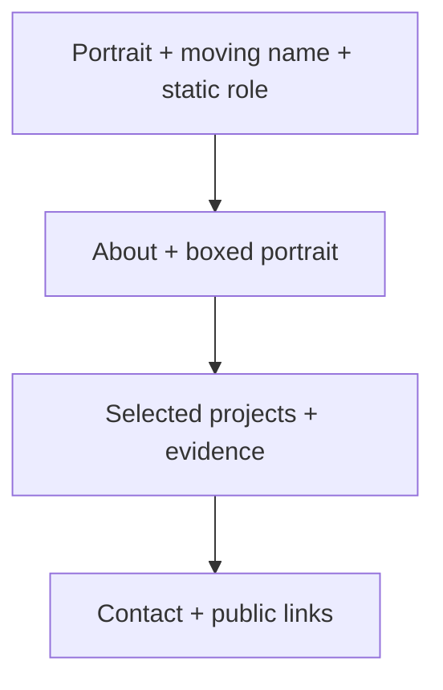

# Portfolio build plan

## Goal and decisions

Make a strong first impression, then make evidence easy to read. Audience: recruiters, collaborators and startups (confirmed). Role: **Backend engineer**; supporting copy can use “software engineer” where accurate. Public name **Nachiappan S K** is confirmed in the user-edited README. Portrait and résumé are supplied at `resources/hero_image.jpg` and `resources/Nachiappan_resume.pdf`. Keep full supplied bio from README; the worksheet mirrors it.

Primary action: **View projects**. Secondary outcome: contact through supplied public email/profile. No blog, dashboard, skill meters, testimonial section or standalone case-study routes in v1.

Stack retained from referenced planning chat: **Vite, vanilla TypeScript, plain CSS, npm**, static single page. No backend or custom domain. Future destination may be GitHub Pages; publication is deferred until the user explicitly requests it.

## References and direction

- [Dennis Snellenberg](https://dennissnellenberg.com/): requested inspiration for portrait opening, oversized moving name and navigation. Borrow hierarchy and movement principles, not assets/code or exact composition.
- [Rithwik](https://www.rtwksai.com/): requested inspiration for readable biography and selected work. Its retrieved page has direct bio/project content; retain that clarity.
- Prior chat `01a19d67-bed0-7c02-ad9b-a4baf1cd3630` was read. Stack and static hosting scope retained; current local-only instruction supersedes publication planning.
- Reference text was retrieved; live animation and responsive appearance were not visually audited during planning.

Design draw: **The name as a monument**, seed **1911319021**, Bricolage Grotesque, edge-to-edge marquee. Raw record: `.taste-skill/direction.json`.

The initial three options were type-only statement, contact sheet and quiet instrument. Each conflicts with the explicitly requested portrait-led hero or restrained content density. Direction changed to name-as-monument for that reason. Keep supplied palette.

Project adaptations override incompatible dealt slots: replace tiled hero rails with one large portrait stage; replace floated bio with a boxed portrait beside prose; replace 9–16-project wall with 2–4 actual project stories; replace venue-address contact and full-screen empty footer with compact personal links and name close. Reasons: requested simplicity, no venue/address content, only two supplied project stories. No extra scroll scenes.

Idea: **On this page, Nachiappan S K’s name and portrait become the opening signature; actual backend work supplies the proof below.** Inspect the supplied photo before deciding crop. Supplied bio emphasizes distributed networking and production ownership; let actual project evidence carry these themes. Live interaction: choose a project from a short title list to jump to its visible story; native anchors work without JS.

## Confirmed subject material

User bio supplies: 3+ years at Oracle Cloud Infrastructure; Tier 0 distributed networking services; backend APIs; infrastructure automation; security and production operations; design through rollout and incident response; cross-team deployment/regional build improvements; Python/PyTorch research; data-drift detection, NLP and computer vision; elected Student Affairs Council role at IIIT Bangalore. These are user-provided claims, not independently audited metrics. Do not invent numerical outcomes, employer screenshots or named project details.

Suggested first-screen copy: **Nachiappan S K** / **Backend engineer** / “I build distributed networking services, backend APIs, and infrastructure automation.” Primary action remains **View projects**. This supporting sentence is drafted from the supplied bio, not quoted from the user. Keep AI/ML and leadership detail in About, subordinate to backend focus.

## Page argument and layout

1. **Hero: who this is.** Real portrait, readable name, static role and one sentence explaining actual work. Desktop: plain nav above portrait occupying roughly half the screen or more; oversized moving name in a separate lower band, not over face or role. One-screen impression without a preloader. Use `min-height`, not rigid viewport height that clips short screens.
2. **About: what this person focuses on.** Heading, 70–120 words from supplied bio, rectangular 4:5 portrait in a surface-colored box. Desktop: prose left, photo right. Mobile: heading, photo, prose. Add experience only when supplied, inside this section.
3. **Projects: proof of capability.** 2–4 stacked stories, strongest first. Each: real screenshot, project name, problem, personal contribution, verified result (or implementation detail when no metric exists), concise technologies, working repository/demo links. First project gets largest image; avoid repeated card grids. A short project anchor list can sit under heading. Mobile: screenshot then text. No invented sample achievements.
4. **Contact: clear next step.** Short invitation, real email and supplied GitHub/LinkedIn. Résumé link only with real PDF. Compact footer repeats name; no huge empty closing screen.



## Navigation, motion and mobile

- Interpret “toggle bars and scroll bars in top” as plain top links **About / Projects / Contact**, a labeled theme switch, hamburger menu on mobile, and slim reading-progress bar at the top. This is a reversible assumption; no custom scrollbar or scroll hijacking.
- Header initially sits above image. If made sticky, use opaque theme background and `scroll-margin-top` so anchors stay visible. Mobile menu is an in-flow disclosure: `aria-expanded`, keyboard support, Escape closes and returns focus.
- Name marquee is the signature motion. Start around 25–40 seconds per cycle; duplicate copies are `aria-hidden`. Keep one fully readable semantic name, one `h1`, plus static role. A long public name may use a separate readable two-line title while decorative band crops.
- Provide visible Pause motion control. Pause on hover/focus and when offscreen; preserve explicit pause. Reduced motion shows static name and stops image drift/entrances. No script means visible content and working native anchors.
- Optional small once-only section entrances and gentle portrait movement use transform/opacity only. Avoid motion quotas that clutter this restrained brief. No pinned scenes, typewriter roles, background videos or loading gates.
- 20px phone / 32px desktop equal gutters; content max-width about 1200px below hero. Body 17–19px, readable measure 60–70ch. Headings at most two lines, at most five size roles. Bricolage Grotesque with system sans fallback; self-host licensed WOFF2 when available, never block rendering on a font request.
- Theme defaults to system preference; persist explicit choice locally with guarded storage. Apply theme before paint. Theme toggling works independently of motion controls.

## Palette and contrast

Exact values are initialized in `design/tokens.css`. Ground 70–90%, accent under 5%; no charts or gradients merely because a series palette exists. Borders retained as tokens, not decorative card outlines.

Brown `#6F4E37` is unsuitable for small text directly on the dark background. Use primary text for links with underlining/focus; use brown as a filled CTA with light foreground. Measure normal text at >=4.5:1, large text and meaningful controls at >=3:1 on actual backgrounds. Use primary text token for focus rings and reading progress in dark mode. Verify CTA separation; use neutral primary-text fill/background-text pairing if brown fails control visibility. Preserve the accent token.

User palette and simple v1 content take precedence over skill defaults. Do not add unrelated images to meet a four-image quota or extra animations to meet a motion quota. Aim for portrait plus real project screenshots where supplied. Record any resulting inspector quota warning honestly; fix actual accessibility/layout failures. No brand recoloring to satisfy an automated aesthetic rule.

## Implementation structure

```text
index.html                 # semantic content, metadata, section anchors
src/main.ts                # initialize small behaviors
src/styles.css             # layout/type/responsive; import tokens
src/theme.ts               # only if theme code warrants separation
src/motion.ts              # marquee pause, reduced motion, entrances
design/tokens.css          # existing exact theme values
content/profile.template.json # input worksheet, not a second rendering framework
public/images/             # supplied/optimized portraits and screenshots
public/documents/          # optional public résumé
package.json + package-lock.json + tsconfig.json
```

Keep fixed biography and project content in HTML so JS is progressive enhancement. Transfer approved worksheet content into HTML; do not create a duplicate runtime content store. No template compiler or extra build plugin.

## Build sequence

1. **Content + setup.** Use confirmed name and supplied portrait; inspect the image and read the résumé for relevant facts and links. Read all three required skills listed in AGENTS.md. Use explicit local draft labels only for still-missing content. Hand-create minimal Vite/TS files in this nonempty folder. Install current stable compatible Vite/TypeScript with exact versions and lockfile. Verify installed package engine requirements; current host Node 22.13.0 meets the Vite guide’s stated 22.12+ floor, but recheck installed release. No Git initialization or deploy workflow needed.
2. **Static first screen.** Apply existing tokens; build desktop/mobile hero without motion. Crop actual portrait with `object-position`; keep face, role, CTA and nav readable. No approval pause required to continue local work.
3. **Full page.** Add biography, real projects, contact. Missing image = clearly labeled local layout slot, no stock person. Missing optional section/link = omit. Optimize actual images to AVIF/WebP plus fallback as needed; explicit dimensions, responsive sources, eager hero, lazy below fold.
4. **Enhancements.** Add theme, menu, reading progress, name marquee and pause. Consider subtle section entrances or portrait drift after browser review. Keep all content readable if JS fails. Use one passive scroll listener batched through requestAnimationFrame for progress and CSS animation for marquee. Use IntersectionObserver only if optional entrances are added.
5. **Verify + handoff.** Type check and production build; serve `dist/` through `npm run preview`. Browser review both themes at 1440/768/390 and overflow at 320px; use skill lint/inspect and screenshot critique, fix top issues. Return preview URL, screenshots/check results and missing content. User reviews locally before any publication request.

Expected commands after builder creates package scripts:

```sh
npm install --save-dev --save-exact vite typescript
npm run dev -- --host 127.0.0.1
npm run check
npm run build
npm run preview -- --host 127.0.0.1
```

## Acceptance checks

- Five-second hero test: visitor can identify name, backend role and project action.
- Actual portrait stays well cropped; no text crosses face; readable static title remains when marquee pauses.
- No horizontal page overflow, clipped controls, hidden sections or heading longer than two lines. Decorative marquee clips within its own band only.
- Keyboard reaches every control; focus visible; menu and motion toggles accurately expose state. Touch targets approximately 44px. Skip link included.
- Both themes pass contrast; theme survives refresh; unavailable storage does not break site.
- Pause, reduced motion and disabled-JS views remain useful. Native scrolling works on touch.
- Project/demo/contact/PDF links resolve; missing links omitted. No placeholder claims presented as facts.
- Production preview has no console errors or missing assets. Run skill visual QA on production output, report deviations. No app tests needed for static copy; focused behavior checks for menu/theme/motion suffice.
- Targets, measured after actual assets: Lighthouse mobile performance/accessibility >=90; initial image budget about 500KB for hero, initial transfer about 1MB. Report actual measurements; these are goals, not promises.

## Content intake

Name, bio, portrait and résumé are supplied in README. Local paths exist; image crop and résumé contents have not yet been reviewed. Reuse portrait for hero and boxed About unless a second image is later supplied. Builder should copy optimized image derivatives and the intended public résumé into `public/`, then link those files; do not expose the entire `resources/` folder. Keep source originals intact.

Two project stories, screenshot paths and public contacts are now supplied in README and mirrored in the worksheet. Build with these two projects; do not wait for more. Campus security analytics comes first. Preserve team attribution and describe demonstration/pilot as historical events, not current deployments. Flash cards app has no supplied project URL: omit its demo/repository action unless the résumé supplies an explicit matching link. Inspect both screenshots before assigning crops and captions. Do not invent technologies for campus analytics, numerical results or private employer details.

Public contacts: nicenach149@gmail.com; GitHub https://github.com/Nachiappan14; LinkedIn https://www.linkedin.com/in/mr-nskn/; mobile 8300843618. Display the supplied phone exactly; use `tel:8300843618` without guessing a country prefix. All were explicitly supplied for public contact.

Required build skills: design-taste-frontend, visualize:visualize and caveman, with exact paths and scope in AGENTS.md.

## Sources and deferred hosting

[Vite guide](https://vite.dev/guide/) confirms vanilla-ts template and Node requirements. [Vite static deployment](https://vite.dev/guide/static-deploy.html) covers production preview and future Pages configuration. For eventual root username.github.io site use base `/`; project subpaths need their matching base. Add deployment workflow only after explicit publication request. Do not repeat hosting research during local build unless a decision changes.

## Screenshot check

`resources/project_1.png` and `resources/project_2.png` are byte-identical (SHA-256 verified). Builder must inspect image content before assigning it. Do not present one screen as two distinct project interfaces; use it only where accurate and omit the other image or use an explicitly labeled local draft slot pending replacement. This does not block the rest of the local build.
